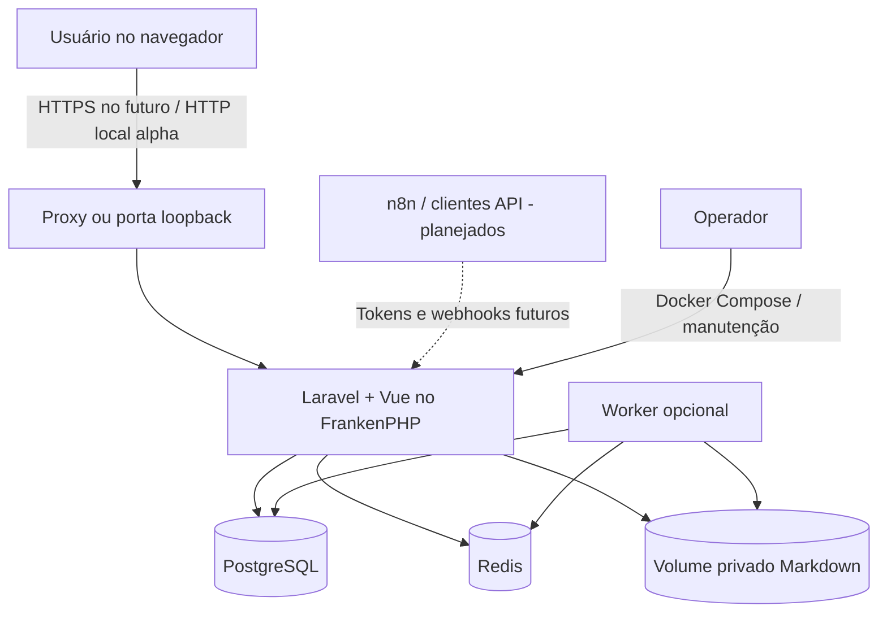

# Arquitetura do sistema

**Estilo decidido:** monólito modular Laravel, interface Vue/TypeScript, persistência híbrida PostgreSQL + Markdown privado. Documento de contexto; detalhes e contratos em [ARQUITETURA/](ARQUITETURA/MODELO_DE_DADOS.md).

## Visão de contexto

A interface é servida pela aplicação. O prefixo `/api` atual está em `routes/web.php`: **é API para a sessão do navegador**, protegida por autenticação/CSRF; **não** é uma API pública versionada para n8n.

## Componentes verificados

| Componente | Responsabilidade | Implementação atual |
| --- | --- | --- |
| HTTP | Login, rotas dos cofres e notas | `routes/web.php` e controllers Laravel |
| Autorização | Validar acesso de usuários a cofres | `VaultPolicy` e checagem de vínculo da nota |
| Domínio | Modelos `User`, `Vault`, `Note` | Eloquent, regras ainda concentradas em controllers |
| Metadados | Usuários, cofres, pivot de membros, notas, versões | Migrations PostgreSQL |
| Conteúdo | Corpos `.md` | Novas revisões privadas imutáveis por UUID; arquivos legados preservados para leitura |
| Interface | Explorar cofre e notas, editar texto | `resources/js/App.vue` (sem CodeMirror) |
| Cache/filas | Redis e worker opcional | Serviços Docker; integrações ainda ausentes |
| Operação | Healthcheck `/up` | CI smoke test; sem health de dependências completo |

## Fluxo de gravação experimental

**Primeira transação:** verificar autorização e versão, bloquear nota e persistir registro de revisão preparada com hash. **Filesystem:** escrever temporário privado, publicar novo objeto imutável e verificar hash. **Segunda transação:** confirmar que versão-base e estado coincidem, publicar ponteiro e revisão no mesmo commit. Não substituir bytes de revisões anteriores.

Em caso de crash após a gravação e antes do commit, o journal persiste e pode ser reconciliado por comando explícito. Se faltar arquivo ou houver divergência, falhar e investigar, sem remover objetos. A escrita não possui durabilidade física pós-queda de energia comprovada; a [ADR 0002](DECISOES/0002-consistencia-de-notas.md) e [issue #3](https://github.com/caiotomaza/cianita/issues/3) permanecem com gates pendentes.

## Limites de domínio propostos

- **Identidade:** contas, sessões, 2FA e tokens.
- **Cofres:** propriedade, membros, papéis e políticas.
- **Notas:** edição, versão, estrutura e ligações.
- **Arquivos:** anexos, importação/exportação, segurança de caminhos.
- **Integrações:** API, webhooks e jobs de entrega.
- **Operação:** backup/restore, auditoria e métricas.

Estas fronteiras são **orientações arquiteturais**, não módulos PHP já separados. Evitar microsserviços e camadas abstratas sem necessidade, mas mover regras transacionais dos controllers para serviços/actions à medida que o domínio crescer.

## Princípios invariantes

1. Nenhuma nota ou anexo de um cofre pode ser lido/modificado via identificador de outro.
2. Markdown é dado primário de conteúdo; metadados e versão são persistidos no banco.
3. Não expor `storage/app/private` diretamente; acessos passam pelo backend.
4. Alterar notas não deve sobrescrever versões concorrentes silenciosamente.
5. Processos assíncronos e integrações preservam as mesmas políticas de autorização.
6. Uma cópia de volume ou uma CI verde não implica integridade/restauração garantida.

## Decisões em aberto

Persistência crash-safe, formato de caminhos/identidade interoperável, contrato de API, permissões administrativas, recuperação e plano de busca: detalhadas em ADRs propostas ou specs. Ver [modelo de dados](ARQUITETURA/MODELO_DE_DADOS.md), [armazenamento](ARQUITETURA/ARMAZENAMENTO_E_INTEGRIDADE.md) e [deploy](INFRAESTRUTURA/IMPLANTACAO_E_AMBIENTES.md).
