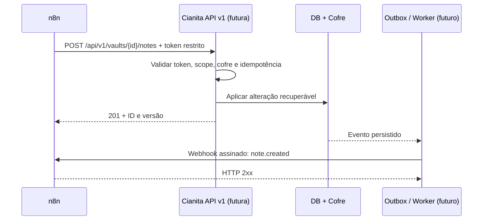

# Integrações e automações — n8n

**Estado:** planejamento. Não existe API com tokens de serviço nem webhooks na base alpha. Redis e worker no Docker são infraestrutura disponível, **não integração pronta**.

## Cenários de uso

1. n8n importa informações de fonte autorizada, normaliza o texto e cria uma nota num cofre específico.
2. Evento `note.updated` comunica revisão de metadados a um workflow que indexa documentação autorizada.
3. Workflow solicita exportação de notas previamente autorizadas ou adiciona tags.
4. Operador recebe notificação de falha de backup ou de saúde da instância, sem conteúdo privado.

## Arquitetura proposta

### Contratos e segurança

- Token com escopos `vault:<id>:read` / `vault:<id>:write` **conceituais**; decidir formato e semântica na ADR.
- Segredos gerados uma vez, armazenados como hashes ou cifrados quando precisarem ser recuperados pelo emissor; nunca registrados em logs.
- Webhook HMAC sobre payload bruto, ID de evento, timestamp, política antirreplay e rotação de segredo.
- Validar URL de destino contra SSRF (DNS rebinding, IP privado/link-local, redirects) e permitir configuração de destinos explícitos; default restritivo.
- Usar outbox durável para eventos correlacionados a mutações persistidas; retries com backoff, dead-letter e acompanhamento.
- Consumers precisam reconhecer eventos duplicados e fora de ordem; não prometer entrega exactly-once.
- Controle de acesso não depende de estar dentro do mesmo Docker network ou VPN.

### Política de falhas

Uma falha de n8n não pode bloquear nem reverter gravação de nota já confirmada. Entrega assíncrona com rastreamento de estado, limite de retries e observabilidade. Implementar circuito para endpoints externos lentos. Nunca fazer operações de backup/restauração apenas com workflows sem mecanismo de consistência na Cianita.

## Entregáveis mínimos

- API `/api/v1` versionada e documentação OpenAPI.
- Criação, escopos, expiração, revogação e auditoria de tokens.
- Gestão de assinaturas e segredos por cofre.
- Eventos `note.created`, `note.updated`, `note.archived` com payload mínimo.
- Exemplo funcional de workflow n8n testado sem dados reais.
- Testes adversariais de escopo, replay, assinatura inválida, timeout e falhas de fila.

Rastreabilidade: [#7](https://github.com/caiotomaza/cianita/issues/7), [ADR 0003](../DECISOES/0003-api-e-eventos.md), [ameaças](../SEGURANCA/MODELO_DE_AMEACAS.md).
