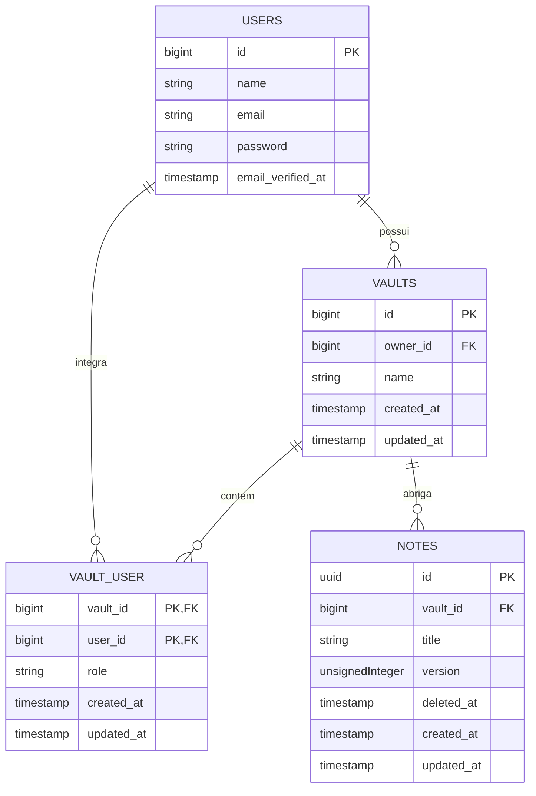

# Modelo de dados e evolução do domínio

**Status:** descrição do esquema atual + propostas futuras claramente separadas. Fonte verificável: `database/migrations/2026_11_15_000001_create_vaults_and_notes_tables.php` e migrations padrão de usuários, jobs e cache.

## Modelo atual

| Tabela | Semântica e restrições verificadas |
| --- | --- |
| `users` | Id, nome, email único, hash de senha e dados de sessão padrão do Laravel |
| `vaults` | Id numérico, `owner_id` com FK para usuário, nome até 120 caracteres |
| `vault_user` | Chave composta (`vault_id`, `user_id`), `role` texto com padrão `viewer`, sem enum/check no banco |
| `notes` | UUID, `vault_id`, título até 180, versão inteira iniciando em 1, `deleted_at` para soft delete |

**Importante:** o dono não precisa de linha duplicada no pivot `vault_user`. A regra de dono é o campo `owner_id`. O esquema não impõe validação de nomes únicos por cofre, caminhos lógicos ou limites de armazenamento. O relacionamento de exclusão em cascata entre usuários/cofres/notas deve ser revisado antes de permitir exclusão administrativa real: pode haver perda indireta.

## Regra da nota

O banco contém metadados e versão; o corpo da nota atual está no disco privado, em `vaults/{vault_id}/notes/{note_uuid}.md` relativo ao disk `local`. Esse caminho **não** preserva a estrutura original de um cofre Obsidian. Nome/título alterados não alteram o arquivo físico.

Invariantes exigidos em todas as versões:

1. `note.vault_id` deve existir, e uma nota só pertence a um cofre.
2. O usuário autenticado deve ter acesso ao cofre e ao tipo de operação.
3. A versão da nota precisa corresponder à revisão esperada em operações concorrentes.
4. A integridade entre metadados e arquivo deve poder ser reconciliada após falha.
5. Uma nota arquivada não deve ser retornada por operações normais, mas seu conteúdo precisa ser recuperável conforme política.

## Evolução proposta — sem migrations implementadas

| Entidade futura | Campos/ideias candidatos | Dependências |
| --- | --- | --- |
| `vault_paths` ou `notes.path` | Caminho lógico único por cofre, árvore de pastas, normalização | ADR de caminhos e importação |
| `attachments` | Id, cofre, caminho privado, MIME detectado, tamanho, hash, criador | Autorização, cotas e AV opcional |
| `note_revisions` | Versão, hash, referência ao blob anterior, autor, timestamp | Política de retenção e recuperação |
| `audit_events` | Ator, ação, escopo, recurso, resultado, correlação | Redaction e privacidade |
| `api_tokens` | Token hasheado, escopos por cofre, expiração, revogação | Modelo de autorização e auditoria |
| `webhook_subscriptions/deliveries` | Endpoint validado, eventos permitidos, tentativas e idempotência | SSRF, fila, observabilidade |
| `backup_manifests` | Versão do formato, hashes, snapshot lógico, local seguro | RPO/RTO e restore testado |

Não criar tabelas apenas porque aparecem nesta lista; aprovar formato, cardinalidades, índices, políticas de retenção e migrações em issue/ADR antes de codificar. Ver [armazenamento](ARMAZENAMENTO_E_INTEGRIDADE.md), [permissões](../SEGURANCA/MATRIZ_DE_ACESSO.md) e [requisitos](../ESCOPO_E_REQUISITOS.md).
