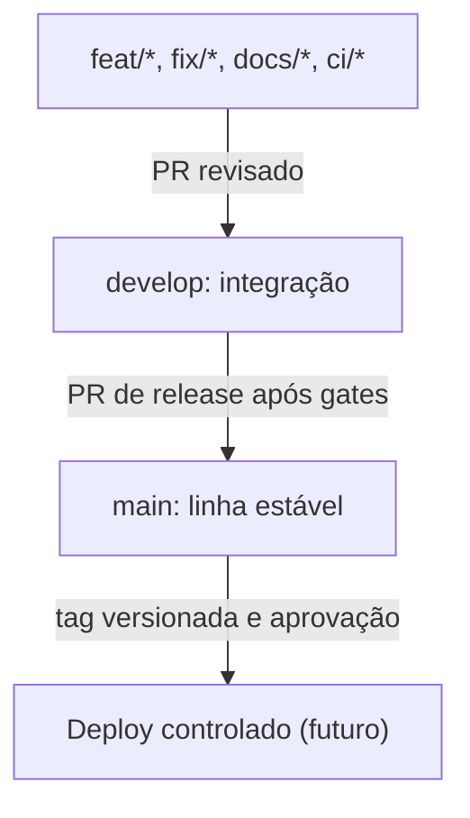

# Fluxo Git, CI/CD e releases

## Estratégia de branches adotada



- `main`: linha estável **após uma release aprovada**; ainda não há versão de produção homologada.
- `develop`: integração da alpha e trabalho em andamento.
- `feat/*`, `fix/*`, `refactor/*`, `docs/*`, `chore/*`, `ci/*` e `test/*`: branches curtas criadas de `develop`.
- `hotfix/*` (futuro): originada da tag de release quando houver incidente crítico; retorno da correção também à `develop`.

PRs funcionais devem ter escopo revisável, commits semânticos em português e testes/documentação correspondentes. Preferir squash merge para alterações comuns. Releases para `main` exigem checklist independente do merge da feature. Rebase/force push de branches compartilhadas não é política padrão.

### Exemplos de commits

```text
feat(cofres): adiciona convite de membros
fix(notas): impede acesso cruzado entre cofres
test(auth): cobre expiração de sessão
docs: documenta processo de restauração
ci: valida migrações com PostgreSQL
feat(api)!: altera esquema de eventos

BREAKING CHANGE: clientes devem migrar para o novo contrato.
```

## Encerramento de branches após integração

- Confirmar `merged=true`, base `develop`, checks exigidos no SHA correto e integração na branch destino **antes** de remover a referência de trabalho.
- Preferir a opção nativa **Settings → General → Pull Requests → Automatically delete head branches**, sem um workflow extra com token de escrita. Essa opção ainda depende de configuração administrativa: [#9](https://github.com/caiotomaza/cianita/issues/9).
- As branches históricas `feat/laravel-docker-foundation` (PR #1) e `docs/centraliza-documentacao-do-projeto` (PR #8) foram integradas, mas a exclusão remota permanece pendente. Usar o botão **Delete branch** de cada PR quando a referência não servir de base a outro PR aberto.
- Para releases/hotfix, sincronizar a correção em `develop` antes da exclusão. Nunca remover `main` ou `develop`.

## CI implementada

Workflow: `.github/workflows/ci.yml`. Gatilhos: push em `main` e `develop`, e PR direcionado a essas branches.

| Job | Validação real |
| --- | --- |
| `php` | PHP 8.4, `composer.lock`, instalação limpa, Composer audit, lint, Pint e PHPUnit em SQLite em memória |
| `frontend` | Node 22, `package-lock.json`, `npm ci`, npm audit, TypeScript (`vue-tsc`) e build Vite |
| `docker` | Config Compose, inspeção de imagens, build com lockfiles, PostgreSQL/Redis, migrations reais e HTTP `/up` + `/login` |

Limitações: lockfiles fixam resoluções de pacotes, mas imagens Docker exigem revisão de digests para reprodutibilidade integral. Sem pipeline de publish/deploy, testes de backup, restore, segurança aprofundada, E2E ou host de homologação. Não declarar CD existente. A CI executou smoke tests com dados efêmeros; isso não cobre operação real.

## Governança no GitHub — pendente ativar

Os documentos estabelecem a política, mas **a proteção efetiva das branches ainda não está habilitada**. Configurar nas regras do repositório:

1. Exigir PR para `main` e `develop` e bloquear force push/exclusão.
2. Exigir checks relevantes de CI no commit atual, sem permitir merge com job pendente/falhando.
3. Definir revisão antes de merge e política explícita de bypass para mantenedores.
4. Usar menor privilégio para GitHub Actions; secrets de produção indisponíveis para PRs.
5. Habilitar prevenção de vazamento de secrets e revisão de dependências quando disponível.

## CD e versionamento futuros

1. Build determinístico com lockfiles e imagens pinadas.
2. Testes e auditoria de dependências; artefato com tag/digest imutável.
3. Deploy em homologação com restore testado e aprovação.
4. PR de release `develop → main`; tag SemVer (`vMAJOR.MINOR.PATCH`) e changelog.
5. Deploy manual ou automação com aprovação explícita, backup prévio válido e smoke tests.
6. Monitorar regressões; reverter imagem **somente se** schema/arquivos forem compatíveis, caso contrário restauração coordenada.

O esquema acima é **desenho**, sem deploy configurado no presente. Referências: [qualidade](TESTES_E_QUALIDADE.md), [DoD](DEFINICAO_DE_PRONTO.md), [deploy](../INFRAESTRUTURA/IMPLANTACAO_E_AMBIENTES.md), [CONTRIBUTING](../../CONTRIBUTING.md).
