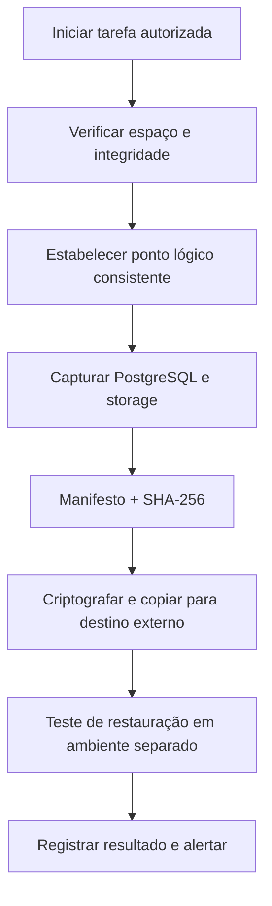

# Backup, exportação e restauração

**Bloqueador:** [#4 — backup consistente e restore testado](https://github.com/caiotomaza/cianita/issues/4). **Não há rotina automatizada nem procedimento de desastre verificado** na alpha. Este documento é uma **especificação operacional proposta**, não função já disponível.

## Distinguir operações

| Operação | Conteúdo/objetivo | Não garante |
| --- | --- | --- |
| **Exportação de cofre** | ZIP/Markdown/anexos para portabilidade de cofre autorizado | Recuperação de usuários, papéis, tokens, configurações |
| **Backup da instância** | Snapshot consistente de banco, storage e configuração/segredos protegidos | Compatibilidade automática com Obsidian |
| **Restauração** | Recriar serviço e reconciliar banco/arquivos a partir de ponto válido | Alterações feitas depois do backup |
| **Versionamento de nota** | Histórico de conteúdo por nota (futuro) | Substituir backup externo |

## Escopo e consistência

1. PostgreSQL: usuários, cofres, membros, notas, versões e índices/auditoria futuros.
2. `cianita_storage`: notas, anexos futuros e persistência essencial.
3. Configurações e **APP_KEY/segredos** em canal **separado e protegido**.
4. Manifesto versionado: ponto lógico, esquema, versão de app, origem, itens e hashes SHA-256.

PostgreSQL e filesystem são distintos. Executar `pg_dump` e `tar` em instantes diferentes, **sem protocolo**, pode gerar cópia inconsistente. A solução deverá estabelecer janela de manutenção com gravações bloqueadas, snapshot coordenado ou objetos de versão imutável + watermark recuperável; decisão vinculada à [ADR 0002](../DECISOES/0002-consistencia-de-notas.md).

## Fluxo futuro de backup

Segredos não pertencem a um ZIP exportável de cofre. Proteger chave de backup separadamente do artefato criptografado e ter cópia off-host.

## Fluxo futuro de restauração

1. Isolar o ambiente novo, sem sobrescrever o volume ativo.
2. Validar procedência, checksums, manifesto e compatibilidade.
3. Recuperar segredos por canal protegido.
4. Restaurar DB e storage **do mesmo snapshot lógico**.
5. Validar referências, hashes e permissões; não apagar órfãos automaticamente.
6. Testar login, isolamento, leitura, escrita e anexos (quando existirem).
7. Documentar ponto recuperado, tempos, divergências e aprovação operacional.

**Nunca ensaiar recuperação sobre a única cópia real existente.**

## RPO/RTO e retenção

Definir objetivos pelo operador **antes da release** e medir em ensaio de desastre. RPO é diferença entre falha e último ponto íntegro; RTO é tempo até recuperação do serviço. Não anunciar valores sem teste. Retenção, criptografia, limpeza segura, cópia externa e alertas serão configuráveis no desenho final.

Logs devem trazer horários, estado, bytes e hashes, nunca conteúdo de notas ou segredos. Ver [observabilidade](OBSERVABILIDADE.md), [operação](OPERACAO_E_INCIDENTES.md) e [requisitos](../ESCOPO_E_REQUISITOS.md).
