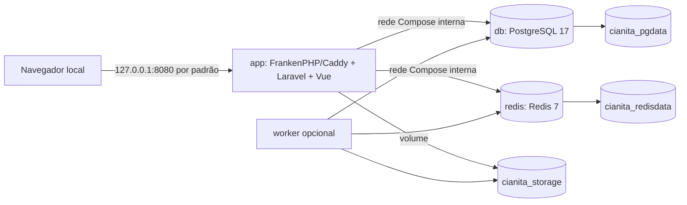

# Topologia de infraestrutura Docker

**Fonte do estado real:** `compose.yaml`, `Dockerfile`, `docker/Caddyfile`, `.env.example`. A configuração passou por build/smoke test na CI, mas **não** constitui implantação homologada em host definitivo.

## Topologia atual

A aplicação `app` atende em `:8080` dentro do contêiner. A porta do host é publicada em `127.0.0.1`, por padrão 8080 (configurável por `CIANITA_PORT`). Outros dispositivos não acessam diretamente sem proxy/rede apropriados. PostgreSQL e Redis não publicam portas no host. O worker compartilha imagem e volume do app, mas inicia somente com `--profile workers`.

## Serviços e dependências

| Serviço | Imagem / build | Persistência | Comportamento |
| --- | --- | --- | --- |
| `app` | Build multi-stage: Node 22 + `dunglas/frankenphp:1-php8.4-bookworm` | `cianita_storage:/app/storage` | Inicia após db/redis saudáveis, healthcheck HTTP `/up` |
| `db` | `postgres:17-alpine` | `cianita_pgdata` | `pg_isready`, credenciais do ambiente |
| `redis` | `redis:7-alpine` | `cianita_redisdata` | `redis-cli ping`, AOF e snapshot Redis |
| `worker` | `cianita:local` | Mesmo storage do app | `php artisan queue:work redis`, perfil opcional |

O `/up` indica resposta HTTP; não comprova integridade PostgreSQL, Redis, espaço, filas ou backup. Não existem limites CPU/RAM declarados no Compose; dimensionamento depende de medição em host real.

## Build e rede

O Dockerfile compila assets Vite no stage Node, instala dependências PHP via Composer no stage PHP e empacota runtime FrankenPHP/Caddy. Os lockfiles Composer/npm são copiados no contexto e utilizados durante o build. Tags de imagens, se não acompanhadas de digest, continuam sujeitas a variação: conferir [procedimento de atualização de dependências](ATUALIZACAO_DE_DEPENDENCIAS.md) e registrar digest antes da homologação. Restrições adicionais de runtime ainda exigem testes. DB e Redis não devem ser expostos à internet, mesmo que já exista autenticação da interface.

## Acesso remoto — proposta

Rede privada (ex.: Tailscale) e proxy HTTPS antes do serviço web. Preservar DB/Redis internos, URL pública correta, cookies seguros e configuração de trusted proxy. Integração Tailscale/proxy **não existe no Compose** e precisa ser testada antes de uso remoto.

## Regras de persistência

- Não colocar Markdown em filesystem efêmero do contêiner.
- Não remover volumes em atualização ou rollback.
- Redis pode recompor cache; operações de fila podem exigir recuperação de estado.
- `cianita_storage` inclui outros diretórios Laravel além das notas.
- Manter futuramente cópia **externa ao host**; Docker volumes não são backup.

Ver [configuração](CONFIGURACAO_E_SEGREDOS.md), [implantação](IMPLANTACAO_E_AMBIENTES.md), [backup](BACKUP_E_RESTAURACAO.md).
