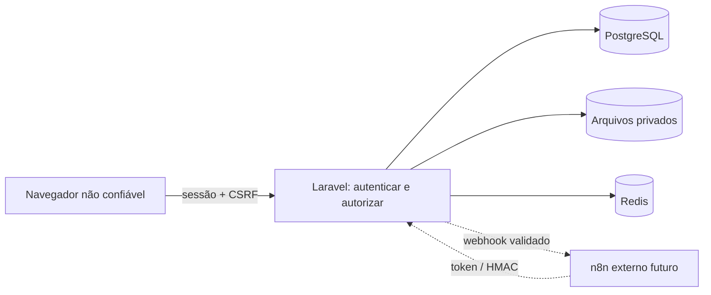

# Modelo de ameaças — visão inicial

**Escopo:** navegador ↔ Laravel ↔ PostgreSQL/Redis/filesystem, e interfaces externas futuras (n8n, importação, webhooks, proxy). Modelo de desenho; **não substitui pentest ou auditoria concluída**.

## Ativos e fronteiras de confiança

- **Alto valor:** conteúdo Markdown, anexos, segredos, hash de senhas, tokens e backups.
- **Superfícies:** login, sessão, rotas de cofre, uploads futuros, ZIP, renderizador Markdown, webhooks, CLI, volumes e rede Docker.
- **Fronteiras:** internet/rede privada → proxy; navegador → Laravel; Laravel → volumes/banco; worker → chamadas externas; administrador → contêiner/host.

## Ameaças prioritárias

| Categoria | Exemplo | Controle existente | Controle ainda necessário |
| --- | --- | --- | --- |
| Identidade/impersonação | Roubo de sessão, brute force | Throttle, regeneração de sessão, auth | HTTPS validado, 2FA, detecção e revogação |
| Autorização/IDOR | Abrir nota de outro cofre | VaultPolicy, checagem de vínculo | Cobertura de todos os recursos futuros |
| Integridade | Crash DB/filesystem, concorrência | Versionamento otimista, temporário | Journal e recovery testado |
| XSS | Markdown com HTML/script | Não há preview rico atual | Sanitizador, CSP, testes de URLs |
| Upload/importação | ZIP traversal, symlink, bomba de descompressão | Recursos ausentes | Validação e quotas antes da entrega |
| SSRF | Webhook aponta para rede interna | Webhook ausente | Allowlist, DNS/redirects, egress |
| Divulgação | Logs/telemetria e backup com notas | Resposta API no-store | Redaction, criptografia e restore seguro |
| Negação de serviço | Arquivos grandes, consultas excessivas | Tamanho de `body` limitado | Quotas, paginação, rate limits, limites de jobs |
| Supply chain | Dependências mutáveis e imagens sem pin | CI funciona | Lockfiles, SBOM, scans, fixação de versões |
| Elevação de privilégio | Editor vira proprietário | Policy limitada | Fluxos de papel auditáveis e testes negativos |

## Regras de engenharia segura

- Tratar títulos, conteúdo, caminhos, ZIP, URLs e JSON de integrações como entradas hostis.
- Validar permissões no servidor e revalidar workers/arquivos temporários.
- Nunca renderizar Markdown não confiável diretamente como HTML bruto.
- Evitar conteúdo e segredos em logs, eventos e respostas de erro.
- Não publicar DB/Redis; em acesso externo, exigir proxy HTTPS configurado e testado.
- Separar backup exportável de cofre de backup de desastre contendo chaves e metadados.
- Testar recuperação e verificação de integridade antes de usar dados insubstituíveis.

## Gatilhos de revisão

Alterações em autenticação, papéis, notas, anexos, importação, backup, integração e rede exigem atualizar o modelo de ameaças e critérios de teste no mesmo PR. Documento vinculado à [matriz](MATRIZ_DE_ACESSO.md), [dados](DADOS_E_PRIVACIDADE.md) e [registro de riscos](../REGISTRO_DE_RISCOS.md).
